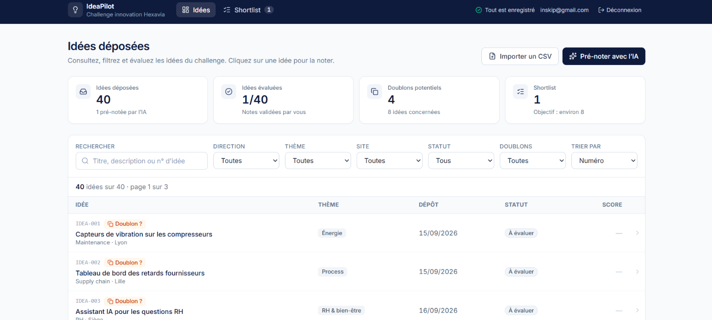
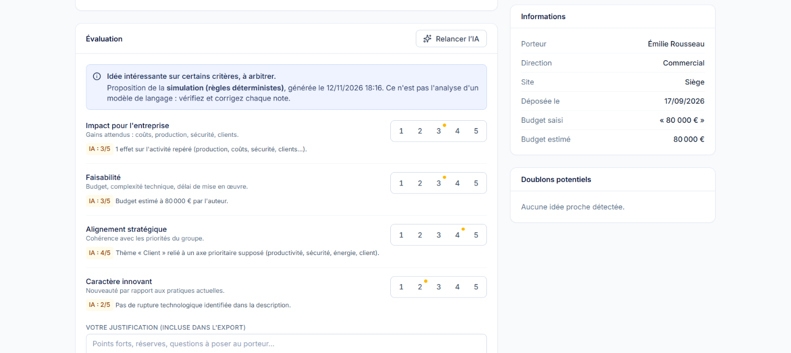
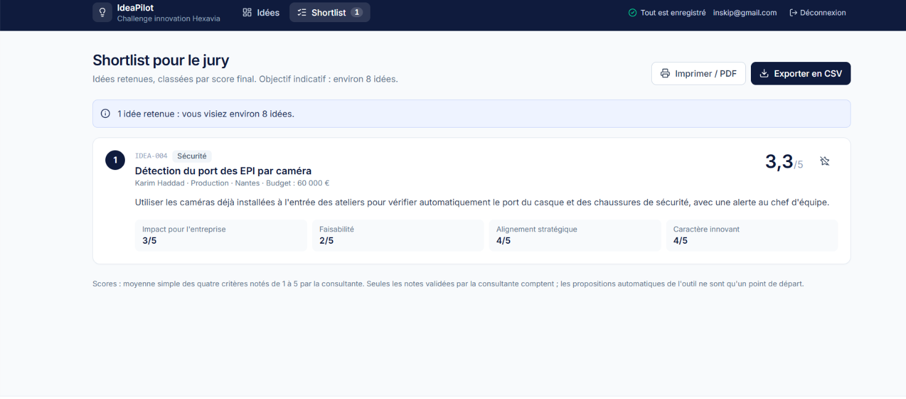

# IdeaPilot

Outil d'aide au dépouillement du challenge d'innovation Hexavia : consulter les 40 idées, les noter
sur la grille du client à partir d'une proposition « IA », repérer les doublons et sortir une
shortlist d'environ 8 idées pour le jury.

## Aperçu

- **Application :** https://inskip-emmanuel.vercel.app/ (base Supabase configurée, 40 idées importées)
- **Compte de démonstration :** `inskip@gmail.com` / `Inskip237`. Il sert uniquement à l'évaluation
  de l'exercice, sur des données fictives, et sera désactivé après la restitution.

| Tableau de bord | Fiche d'une idée | Shortlist |
| --- | --- | --- |
|  |  |  |

## Lancer l'outil

```bash
npm install
cp .env.example .env.local   # URL et clé publique d'un projet Supabase
npm run dev                  # http://localhost:5173
```

Pour une nouvelle base Supabase (une seule fois, environ 3 minutes) :
1. SQL Editor : exécuter [`supabase/migrations/20261112170000_init_ideapilot.sql`](supabase/migrations/20261112170000_init_ideapilot.sql).
2. Authentication > Users > Add user (« Auto confirm »), puis désactiver les inscriptions publiques.
3. Autoriser ce compte : `insert into public.team_members (user_id) select id from auth.users where email = '…';`
4. Se connecter et importer `data/idees_hexavia.csv`. L'import est idempotent : le relancer ne crée aucun doublon.

Tests : `npm test`.

## 1. Cadrage

**Besoin.** Camille dépouille à la main, dans Excel, une quarantaine d'idées. Elle veut les voir et
les filtrer au même endroit, et les noter de façon cohérente sur 4 critères de 1 à 5, en partant
d'une proposition de l'IA qu'elle corrige. Elle veut aussi repérer les doublons et envoyer au
client une shortlist d'environ 8 idées, avant le jury, dans dix jours.

**Utilisatrice :** Camille, consultante non technique. Le client et le jury reçoivent un export.

**Hypothèses :** score final = moyenne simple des 4 critères (pas de pondération donnée) ; seules
les notes validées par Camille comptent ; la stratégie d'Hexavia étant inconnue, l'IA suppose comme
prioritaires la productivité, la sécurité, l'énergie et le service client ; « environ 8 » est une
cible indicative, pas une contrainte ; un doublon est signalé, jamais fusionné ; le budget saisi
librement est conservé tel quel ; une base par challenge, partagée par l'équipe.

**V1 :** liste filtrable et paginée, fiche détaillée, notation avec justification, proposition IA
simulée, doublons, shortlist, export CSV et PDF, import CSV réutilisable, connexion, sauvegarde en ligne.
**Plus tard :** vrai modèle d'IA (prêt à brancher), plusieurs évaluateurs, pondération,
fusion de doublons, plusieurs challenges par base.

## 2. Conception

- **Architecture.** React + Vite, en trois couches :
  - `src/domain` : règles métier pures (notation, doublons, filtres, shortlist), testées sans React ni base ;
  - `src/data` : import CSV et accès à Supabase derrière une interface `IdeaPilotRepository` ;
  - l'interface.
- **Données.** Cinq tables : `ideas` (identifiant du CSV `IDEA-001…` comme clé, budget et date
  d'origine conservés), `ai_suggestions` et `evaluations` (deux tables distinctes, pour que relancer
  l'IA ne puisse jamais écraser une note de Camille), `shortlist`, `team_members`. Notes contraintes
  à 1–5 en base. Score, statut et doublons sont calculés, jamais stockés.
- **Sécurité.** Supabase Auth et RLS sur toutes les tables, aucun accès anonyme. Il faut être
  connecté **et** membre de l'équipe pour lire les noms des auteurs. Seule la clé publique est dans
  le navigateur. Le CSV n'est pas servi par l'application.
- **IA.** Interface `AiScoringProvider`. En V1, une simulation déterministe à base de règles,
  présentée comme telle, qui signale les informations manquantes. Un vrai modèle (Claude, via une
  fonction serveur qui garde la clé) est prêt et s'active par configuration. Le nom de l'auteur
  n'est jamais envoyé.
- **Doublons.** Normalisation, mots vides, synonymes, puis similarité de Jaccard. Seuils calibrés
  sur les vraies données et ajustables dans le code.
- **Stack**, choisie pour coller aux outils INSKIP (React, TypeScript strict, Supabase, Vercel) :
  plus Tailwind, Papa Parse pour un CSV imparfait, Vitest et GitHub Actions.

## 3. Construction avec l'IA

**Assistant :** Claude Code (Claude Opus 5.5), guidé par [`AGENTS.md`](AGENTS.md) : architecture,
règles métier non négociables, sécurité et pièges déjà rencontrés.

**Prompts les plus utiles :**
1. « Ne commence pas par générer du code. Analyse d'abord les documents et inspecte l'environnement. »
2. « Le score final ne doit jamais être remplacé silencieusement par la simulation IA. »
3. « Détection lexicale simple […] seuil documenté et ajustable dans le code. »
4. « Ne jamais inventer de résultats de tests, de commits, de déploiement ou d'événements du journal. »
5. « Supabase est désormais notre solution principale de persistance […] Ne pas exposer
   publiquement les noms des auteurs. »

**Quand l'IA s'est trompée.**
- **Seuil des doublons.** Son premier seuil, choisi a priori, ratait « Assistant IA RH » / « Chatbot
  RH » et signalait un faux doublon entre deux idées sans rapport (le mot commun « salariés »). Je
  l'ai vu en affichant toutes les paires avec leur score. Le seuil a été recalibré sur les données,
  et ces cas sont figés dans les tests.
- **CI.** Elle a annoncé la CI réparée après une vérification locale, mais le run suivant a encore
  échoué. La vraie cause n'est apparue qu'en reproduisant l'environnement exact de la CI : npm 10 et
  npm 11 lisent différemment le même lockfile.

## 4. Fiabilisation

**103 tests Vitest**, sans réseau ni base, sur ce qui fausserait le travail de Camille :
- l'import des 40 idées (séparateur `;`, champs vides, date au format français, budgets libres comme `15k€` ou `?`) ;
- la notation (moyenne, bornes 1–5, l'IA n'écrase jamais une note humaine) ;
- les doublons (vrais doublons détectés, faux positifs connus exclus) ;
- la shortlist et son export CSV ;
- la couche Supabase (import idempotent, clé secrète refusée, RLS vérifiée sur la migration) ;
- la future route IA (pas d'appel sans clé, sans session ou hors équipe).

Vérifié aussi contre la vraie base : un visiteur non connecté ne peut rien lire ni écrire.
**CI** : à chaque push, installation, vérification TypeScript, tests et build.

## 5. Livraison

- **Hébergement.** Vercel, avec trois variables publiques (`VITE_SUPABASE_URL`,
  `VITE_SUPABASE_PUBLISHABLE_KEY`, `VITE_AI_PROVIDER=mock`).
- **Secrets.** Aucune clé technique dans le dépôt : `.env*` est ignoré et seul `.env.example` est
  versionné. Le seul identifiant publié est le compte de démonstration ci-dessus, volontairement.
  Avec de vraies données, chaque personne aurait son propre compte, transmis à part.
- **Brancher un vrai modèle.** Ajouter `ANTHROPIC_API_KEY` côté serveur, passer
  `VITE_AI_PROVIDER=http`, puis redéployer.

**Avant de confier l'outil à Camille :**
- lui créer un compte nominatif et désactiver le compte de démonstration ;
- faire valider par le client l'envoi des idées à un modèle externe ;
- garder à l'esprit qu'une base correspond à un challenge, et que si deux personnes notent la même
  idée en même temps, c'est la dernière sauvegarde qui l'emporte ;
- garder la base active : un projet Supabase gratuit se met en pause après une semaine sans activité.

## 6. Journal

| Heure | Étape |
| --- | --- |
| 16:21 | Lecture du brief et du CSV, audit des données, plan |
| 16:21–16:49 | Domaine métier, IA simulée, calibration des doublons, interface, 65 tests, CI, premier push |
| 16:52–17:05 | Passage à Supabase (Auth + RLS), migration, connexion ; 79 tests |
| 17:07–17:29 | Base Supabase configurée, idées importées ; CI réparée (npm 10 / 11) |
| 17:34–17:48 | Pagination, filtre des doublons ; déploiement Vercel |
| 18:05 | Vrai modèle IA prêt à brancher (inactif sans clé) ; 103 tests |
| 18:09–18:21 | Vérification en ligne, captures, README |

Heures issues de l’historique Git, sauf la configuration Supabase et le déploiement Vercel, faits entre deux commits.

## 7. Suite et questions pour Camille

**Avec une journée de plus :**
- brancher le vrai modèle et le comparer à la simulation sur des idées notées par Camille ;
- noter à plusieurs, avec consolidation des notes et un accès en lecture seule pour le client ;
- marquer « pas un doublon » ;
- tests d'interface sur le parcours principal.

**Questions :**
1. Les 4 critères ont-ils le même poids ? Y a-t-il un critère éliminatoire ?
2. Quels sont les axes stratégiques d'Hexavia, pour noter l'alignement ?
3. Notez-vous seule, ou à plusieurs ?
4. Quel format le client attend-il pour la shortlist : CSV, PDF, présentation ?
5. Les noms des porteurs doivent-ils figurer dans ce qui est envoyé au jury ?
6. Pour deux idées en doublon : en retenir une, les fusionner, ou réunir les porteurs ?
